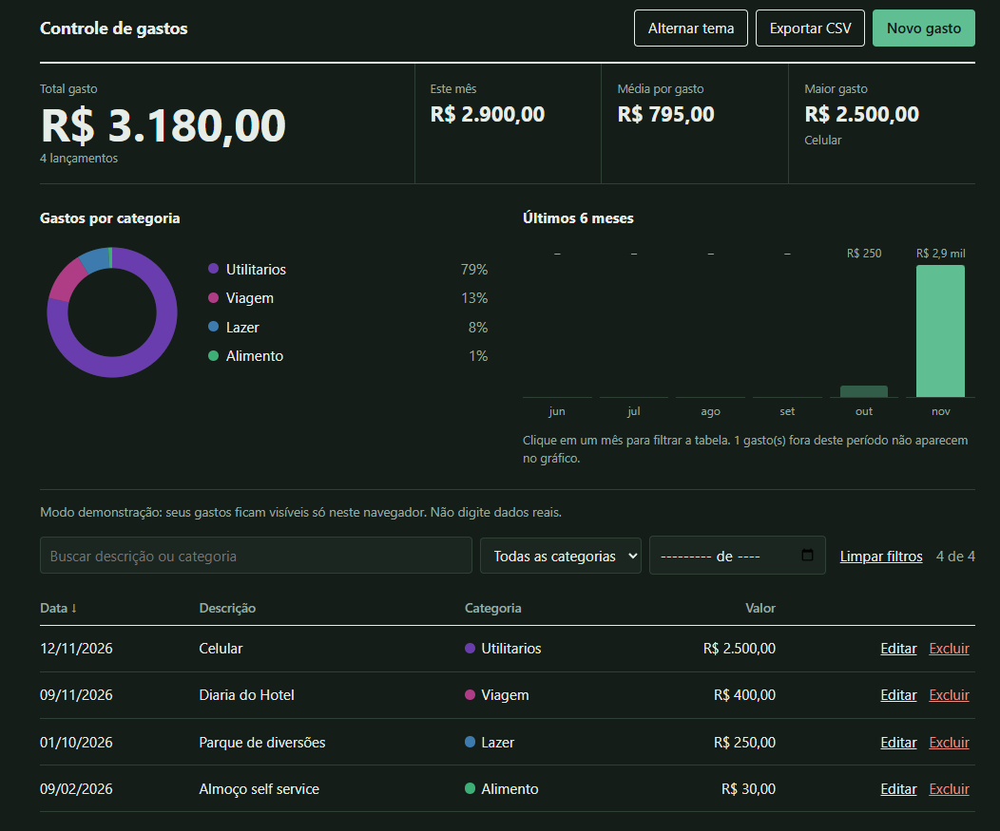

# Controle de Gastos

Aplicação web para registrar e acompanhar gastos pessoais: API REST em **Spring Boot**, banco **MySQL** e um painel em HTML, CSS e JavaScript puro, que mostra total, média, gastos por categoria e por mês.

**Demonstração:** https://controle-gastos-five-beta.vercel.app/

> O servidor roda em um plano gratuito e "dorme" quando fica parado. No primeiro acesso, a página pode levar até cerca de 1 minuto para carregar, e ela avisa isso enquanto espera.


## Sobre o projeto

Projeto de estudo para praticar Spring Boot e fazer um deploy no projeto. No Spring Boot foi feito um CRUD para as alterações com os gastos e no deploy foi feito a hospedagem do frontend no vercel que recebe resposta do backend no render que pega informações do TiDB cloud que está hospedando o banco de dados.

## Funcionalidades

- Cadastro, listagem, edição e exclusão de gastos (descrição, valor, categoria e data).
- Indicadores: total gasto, gasto do mês, média por gasto e maior gasto.
- Gráfico por categoria (clique na legenda para filtrar) e gráfico dos últimos 6 meses (clique em um mês para filtrar).
- Busca por texto, filtro por categoria e mês, e ordenação clicando nos cabeçalhos da tabela.
- Exportação para CSV e tema claro/escuro.
- Feedback de carregamento nas requisições, evitando cliques repetidos enquanto o servidor responde.
- Validações com mensagens claras, devolvidas pela API e exibidas na tela.

## Tecnologias

| Camada | Tecnologia |
|---|---|
| Back-end | Java 17, Spring Boot 4.1, Spring Web MVC, Spring Data JPA (Hibernate), Bean Validation |
| Banco de dados | MySQL 8 localmente; TiDB Cloud (compatível com MySQL) na nuvem |
| Front-end | HTML, CSS e JavaScript puro (um único arquivo, sem frameworks) |
| Deploy | Docker + Render (API e página), Vercel (página, com proxy para a API) |

## Arquitetura

```
Navegador ──► Vercel (index.html) ──rewrite──► Render (Spring Boot) ──► TiDB Cloud (MySQL)
```

O `vercel.json` encaminha `/gastos` para a API na Render. Como o navegador só fala com a Vercel, não há problema de CORS. O Spring também serve o `index.html` da pasta `static`, então o endereço da Render mostra a mesma página.

Dentro da API, cada camada tem uma responsabilidade:

```
Controller  →  Service  →  Repository  →  Banco
URLs e JSON    regras      acesso a dados
```


## Como rodar localmente

**Pré-requisitos:** Java 17 ou superior e MySQL 8 em execução na porta 3306.

1. Clone o repositório:
   ```bash
   git clone https://github.com/ndu-xl/ControleGastos.git
   cd ControleGastos
   ```
2. Crie um arquivo `.env` na raiz, com os dados do **seu** MySQL (ele já está no `.gitignore`):
   ```
   USER_DB=root
   PASSWORD_DB=sua_senha
   ```
3. Rode a aplicação pela IDE (classe `ControleGastosApplication`) ou pelo terminal:
   ```bash
   ./mvnw spring-boot:run
   ```
4. Abra http://localhost:8080.

O banco `controle_gastos` é criado automaticamente e o Hibernate cria a tabela `gasto` na primeira execução.

### Variáveis de configuração

| Variável | Obrigatória | Padrão | Descrição |
|---|---|---|---|
| `PASSWORD_DB` | Sim | — | Senha do banco |
| `USER_DB` | Não | `root` | Usuário do banco |
| `DB_URL` | Não | MySQL local | URL JDBC completa (usada na nuvem) |
| `PORT` | Não | `8080` | Porta do servidor |

Nunca coloque senhas no código ou no repositório: use o `.env` localmente e as variáveis de ambiente no serviço de hospedagem.

## Autor

Feito por [Eduardo França](https://github.com/ndu-xl).
